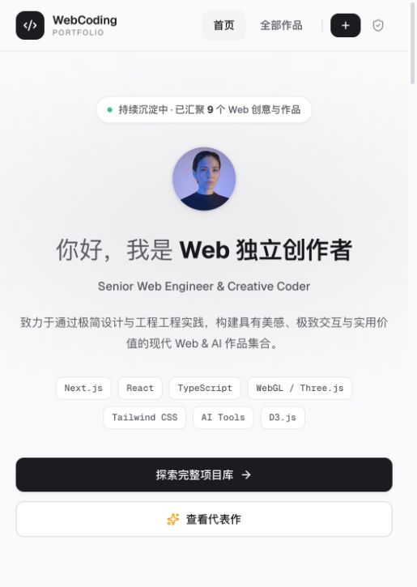
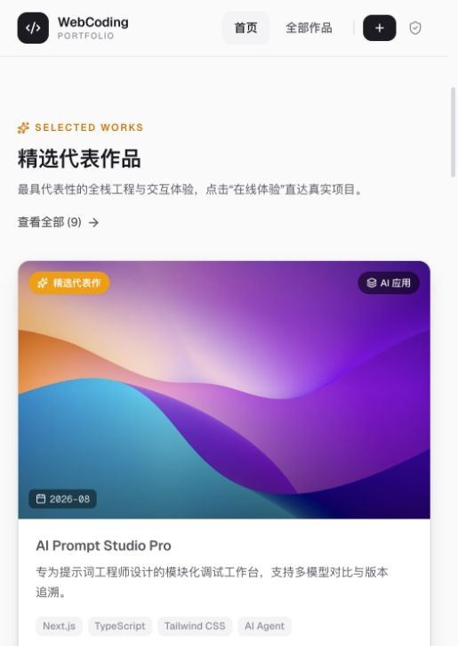
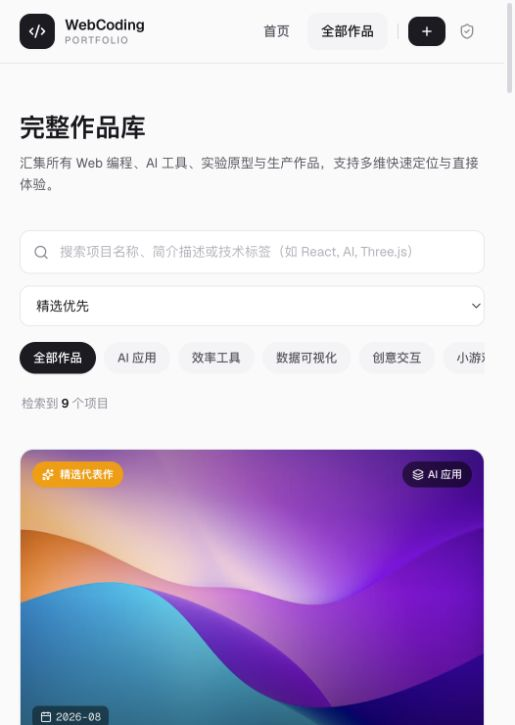

# WebCoding · 作品集合平台

一个用于展示、检索和管理个人 Web / AI 作品与长文内容的全栈项目。前台展示精选作品、完整作品库、个人博客和可选背景音乐，后台维护项目、文章、分类、歌单和个人资料。

[在线体验](https://webcoding-show.vercel.app) · [完整作品库](https://webcoding-show.vercel.app/projects) · [个人博客](https://webcoding-show.vercel.app/blog) · [部署与数据迁移](docs/vercel-deployment.md)

## 项目截图

以下为线上页面的真实截图，展示窄屏响应式布局。截图采集于 2026-09-20；页面内容可通过后台更新。

| 首页 · 个人名片 | 精选作品 · 项目卡片 | 作品库 · 搜索与筛选 |
| --- | --- | --- |
|  |  |  |

## 主要功能

- **作品展示**：个人名片、精选代表作、分类导航、完整技术标签，以及作品详情、在线体验和源码链接。点击卡片内容进入详情页，点击图片放大查看。
- **作品检索**：关键词搜索、分类筛选、分页，以及精选优先、排序权重和完成时间等排序方式。
- **个人博客**：精选文章、关键词/分类/标签筛选、独立文章详情、相关阅读、上下篇导航与 SEO Sitemap。
- **音频播客**：后台通过 RSS 导入节目、同步新单集与去重；前台按节目筛选、查看单集详情，使用跨页面播放器播放、拖动进度、调节音量与倍速。播放播客时暂停背景音乐。
- **Markdown 写作**：后台支持实时预览、GFM 表格/任务列表/代码块、封面上传、阅读时长估算和精选文章。原始 HTML 不会执行。
- **发布流程**：文章可先保存为不完整草稿，只有摘要和正文完整后才能发布；未登录访客无法通过页面或 API 读取草稿。
- **内容统计**：后台逐篇展示作品、文章的累计／今日浏览量，逐集展示播客浏览与播放量，并记录作品的在线体验、视频链接点击；支持热度排序、近 7 天趋势和热门内容排行。
- **后台管理**：项目新增与编辑、草稿与发布状态、精选设置、分类管理、个人资料维护。
- **链接导入**：独立的后台入口，粘贴公开网站或 GitHub 仓库地址后，自动提取资料、匹配分类并存为草稿；可直接打开草稿补充和发布，重复地址返回已有作品。
- **视频链接**：新增和编辑作品时可填写第三方视频的完整 http/https 地址，作品卡片与详情页显示“观看视频”，在新标签页打开视频平台。留空不显示，清空保存即可移除。
- **图片管理**：上传封面与头像，每个作品可额外添加 20 张图片，支持批量上传、图片链接、调整顺序和移除。前台相册支持切换、放大、键盘方向键及 Esc 关闭。支持 PNG、JPEG、WebP、GIF，单张最大 4 MiB；云端使用 Vercel Blob 持久化保存。
- **背景音乐**：后台可上传歌曲或添加公开音频外链，设置前台开关、默认歌曲、音量、自动播放和歌单循环；访客可在悬浮播放器中播放、切歌、选择歌曲和调整自己的音量。支持 MP3、M4A、WAV、OGG，单个文件最大 25 MiB。
- **访问控制**：管理员密码登录、签名会话和 HttpOnly Cookie；生产环境使用 Secure Cookie，未登录访客无法读取草稿。
- **双环境开发**：本地 SQLite，生产 PostgreSQL；提供数据导出、导入和本地图片、音频迁移脚本。

## 技术栈

| 模块 | 技术 |
| --- | --- |
| 全栈框架 | Next.js 16.3.5 · App Router · TypeScript |
| UI | React 19.2 · Tailwind CSS 4 · Lucide React |
| 数据库 | Prisma 6.19.3 · SQLite（本地）· Neon PostgreSQL（云端） |
| 图片与音频存储 | 本地文件 / Vercel Blob |
| 认证 | Web Crypto HMAC 签名会话 · HttpOnly Cookie |
| 部署 | Vercel · GitHub `main` 分支自动部署 |

## 本地运行

建议使用 Node.js 24，与当前 Vercel 项目的运行时保持一致。

### 1. 获取项目

```bash
git clone https://github.com/Eason-Xi/WebCodingShow.git
cd WebCodingShow
cp .env.example .env
```

编辑 `.env`：保留本地 SQLite 的 `DATABASE_URL="file:./dev.db"`，设置独立的 `ADMIN_PASSWORD`（至少 12 位）和随机 `JWT_SECRET`（至少 32 位）。项目不提供默认管理员密码。

### 2. 安装依赖并初始化数据库

```bash
npm ci
npx prisma db push
npm run db:seed
```

`db:seed` 会写入演示分类、标签和项目，仅用于初始化演示环境；不要对已有真实数据的生产数据库执行。演示作品的介绍和外链是占位内容，正式使用时请在后台替换。

已有本地数据库升级时，运行 `npm run db:generate` 和 `npx prisma db push` 同步模型即可，无需重新 seed。生产部署会自动执行 PostgreSQL 增量迁移，不会改动已有项目数据。

### 3. 启动开发服务

```bash
npm run dev
```

打开 [本地首页](http://localhost:3000)，访问 [管理后台](http://localhost:3000/admin) 并使用 `.env` 中的管理员密码登录。

> `.env.local` 的优先级高于 `.env`。从云端环境切回 SQLite 时，先移走云端环境文件，运行 `npm run db:generate`，再重启开发服务。

## 查看内容统计

后台首页展示累计与今日数据、近 7 天趋势及热门内容；项目、文章列表可按累计浏览量排序，播客管理支持逐集查询与播放量排序。首页和播客统计可点击“刷新统计”，项目和文章列表刷新页面后读取最新数据。

- 浏览：访客打开可见的作品、文章或播客详情页后计数；预加载链接、首页卡片曝光不计入。
- 播客播放：站内音频触发实际开始播放时计数，播放失败不计；不包含外部播客平台的播放。
- 视频与在线体验：作品卡片和详情页的对应链接点击均计数；视频链接点击不等同于外部平台的实际播放。
- 去重：同一浏览器、同一内容、同类事件在连续 30 分钟内只计一次，窗口跨午夜仍有效。管理员保持登录时的访问与常见爬虫请求会被排除。
- 日期：按 `Asia/Taipei`（UTC+8）归档。功能启用之前的数据无法补算；总览保留已删除内容的历史流量，排行仅列出现存内容。

本地已有数据库运行 `node scripts/prisma.mjs db push`；生产构建自动应用 `20261028010000_content_analytics` 增量迁移。浏览器使用本地随机标识去重，不保存 IP；服务端仅保存匿名标识摘要的短期去重凭据，过期后在后续统计请求中清理。清除浏览器存储、换设备或主动伪造请求仍可能产生额外计数，因此这属于站内运营统计，不是审计或计费数据。

数据导出版本 5 同时保存累计计数和按天汇总，不导出短期去重凭据；仍可导入旧版本内容备份。数据收集不依赖第三方统计服务或新增环境变量。

## 维护音频播客

登录后进入 `/admin/podcasts`，粘贴 RSS 2.0 音频订阅地址，点击“导入并发布”。系统读取节目名称、简介、作者、封面和 audio enclosure 音频地址，数据存入数据库，前台 `/podcasts` 即可收听。

点击“同步更新”重新读取 RSS，按节目与 GUID 去重（无 GUID 时使用音频 URL），更新已有单集并添加新单集；源中不再出现的历史单集会保留。当前采用手动同步，不包含定时抓取。首次使用本地已有数据库需运行 `node scripts/prisma.mjs db push`；生产部署执行已提交的 PostgreSQL 迁移。

音频直接从原始发布地址播放，不复制托管。无封面显示默认图标；失效音频显示播放错误。RSS 读取使用公开网络校验、重定向校验、25 秒超时和 2 MiB 大小限制。RSS 描述以纯文本显示，音频播放器支持跨站内页面保持播放、进度拖动、音量与倍速；刷新页面后需重新选择播放。

示例 RSS：`https://eason-xi.github.io/DailyBoke/rss.xml`。本地导入的数据不会自动复制到生产数据库，上线后可在后台使用同一地址导入。

## 通过项目地址导入

登录后打开 [链接导入](http://localhost:3000/admin/import)，也可以从后台侧栏或“项目管理”进入：

1. 粘贴项目网站或 GitHub 仓库的完整 `http/https` 地址。
2. 分类默认自动匹配，也可以手动指定。未匹配到分类时进入“导入待整理”。
3. 点击“导入并保存草稿”，成功后打开“检查并编辑草稿”，检查资料并在编辑页发布。

网页导入读取标题、描述、分享封面与关键词；GitHub 还读取仓库简介、README 摘要、语言和 Topics。只使用可获取的信息，不会凭空生成介绍；缺失信息会明确提示。图片保留来源链接，可在编辑页替换上传。GitHub 完成年月来自最近推送月份，需要核对。需要登录、验证码或纯客户端渲染的网站可能无法提供完整资料。

所有新导入作品固定为草稿，不会自动显示在前台。重复导入会返回已有记录，不覆盖手动修改或改变发布状态。抓取失败不创建项目。读取仅支持公开地址和标准端口，逐次检查重定向、限制响应大小和超时；本机代理返回虚拟 DNS 地址时，通过 Cloudflare 公共 DNS 查询实际公网地址后再读取。

独立接口：`POST /api/projects/import`，复用管理员登录会话。请求体为 `{"url":"https://github.com/owner/repo","categoryId":"可选的已有分类 ID"}`；新建返回 `201`，已存在返回 `200`，响应包含 `project`、`duplicate` 和 `warnings`。省略 `categoryId` 即自动分类，提交其他发布状态参数也不会改变草稿默认行为。原有 `/api/fetch-meta` 仍只提取信息，不写入数据库。

## 常用命令

| 命令 | 用途 |
| --- | --- |
| `npm run dev` | 生成 Prisma Client 并启动开发服务 |
| `npm run build` / `npm run start` | 生产构建 / 启动生产服务 |
| `npm test` | 会话、上传规则、博客校验和数据库模型一致性测试 |
| `npx tsc --noEmit` | TypeScript 类型检查 |
| `npm run db:generate` | 根据环境变量选择 SQLite 或 PostgreSQL Client |
| `npm run db:migrate` | 应用已提交的数据库迁移 |
| `npm run data:export` | 将现有内容备份至本地 `backups/` |
| `npm run data:import` | 将备份导入空 PostgreSQL 数据库并迁移本地图片 |

## 部署到 Vercel

当前线上地址为 [webcoding-show.vercel.app](https://webcoding-show.vercel.app)，连接仓库 `Eason-Xi/WebCodingShow` 的 `main` 分支。

部署时需要配置以下环境变量，具体步骤见 [部署与数据迁移说明](docs/vercel-deployment.md)：

| 环境变量 | 用途 |
| --- | --- |
| `DATABASE_URL` | PostgreSQL 池化连接地址 |
| `DIRECT_URL` | PostgreSQL 直连地址，用于数据库迁移 |
| `BLOB_READ_WRITE_TOKEN` | Vercel Blob 图片与音频存储读写凭证 |
| `ADMIN_PASSWORD` | 独立的管理员密码，至少 12 位 |
| `JWT_SECRET` | 随机会话签名密钥，至少 32 位 |
| `GITHUB_TOKEN`（可选） | 服务端 GitHub 访问凭证，提高仓库读取限额；读取私有仓库需要相应权限 |

录入作品时，在“线上 URL”填入 GitHub 仓库地址并点击“智能提取项目信息”，或在“源码 GitHub URL”旁点击“自动填写标签与扩展字段”。系统合并仓库 Topics、主要语言与 README 中识别到的技术为标签，并用 README、仓库简介和语言统计补充技术说明。标签以逗号分隔，可保留 `Tailwind CSS` 等带空格的名称。完成年月取仓库最近推送月份作为建议，可手动修改；排序权重由管理员设置。API 限流时会尝试读取公开仓库页面，无法获取的完成年月留空。其余已填写字段会保留，导入结果需检查后再发布。

`vercel.json` 使用 `npm run vercel-build`，依次检查配置、生成 Prisma Client、应用 PostgreSQL 迁移并构建应用，不会自动写入演示数据。

请勿提交 `.env`、云端凭证、数据库文件或备份。Preview 应使用独立数据库或 Neon 分支，避免测试影响生产数据。

## 项目结构

```text
src/
├── app/
│   ├── page.tsx             # 首页：个人名片、精选作品、最新文章、分类导航
│   ├── projects/            # 完整作品库
│   ├── blog/                # 博客列表与动态文章详情
│   ├── admin/               # 登录、仪表盘、项目、文章、分类、音乐和个人资料管理
│   └── api/                 # 项目、文章、音乐、认证、上传等接口
├── components/              # 导航、页脚、项目卡片和前台播放器等组件
├── lib/                     # 认证、Prisma 客户端和上传规则
└── proxy.ts                 # 后台路由访问保护
prisma/
├── schema.prisma            # 本地 SQLite 模型
├── seed.ts                  # 演示数据初始化
└── postgresql/              # 生产 PostgreSQL 模型与迁移
scripts/                     # 数据库切换、部署构建、数据迁移脚本
tests/                       # 自动化测试
docs/                        # 部署文档与项目截图
```
